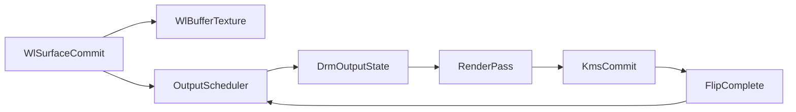
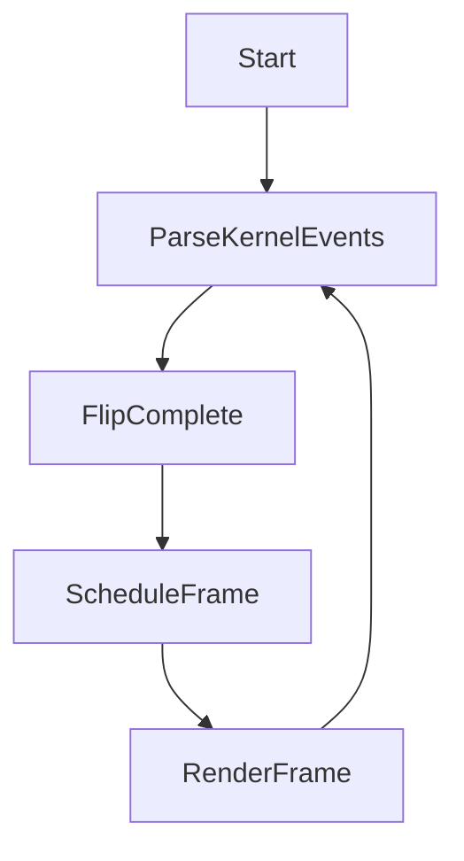
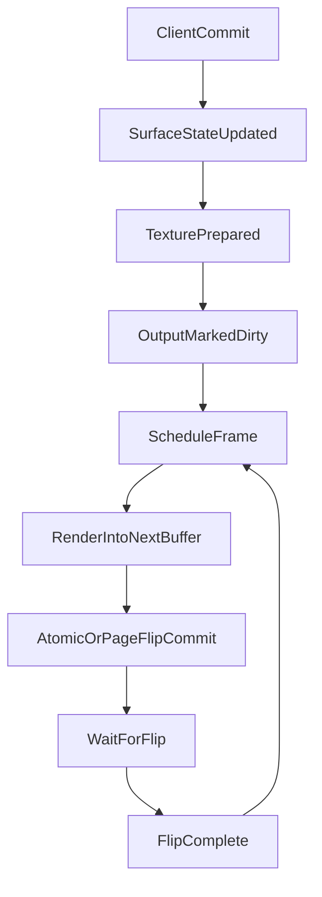

# DRM Output Architecture Plan

## Goal

Reshape the display path so `[src/drm.rs](/home/sebastien/travaux/my_wayland/src/drm.rs)` becomes a minimal output backend with correct framebuffer ownership, a real flip-driven frame loop, and a compositor-facing `schedule_frame()` path. Keep `[src/egl.rs](/home/sebastien/travaux/my_wayland/src/egl.rs)` as the rendering primitive layer for now.

This plan is intentionally more descriptive than a normal execution checklist because the codebase is at a point where architecture choices matter more than line-by-line edits. The intended end state is not “more EGL helpers”; it is “a compositor that owns one correct output loop from client commit to flip completion”.

The shortest summary is:

- fix correctness bugs in the DRM/KMS layer first
- introduce one explicit output runtime model
- make frame submission flip-driven rather than timer-driven
- only after that, layer in minimal composition and later rendering sophistication

The target is not to clone `jay`, Aquamarine, Weston, or wlroots. The target is to borrow the smallest set of architectural ideas that fit this repository's existing model:

- `State` remains the world state
- `Runner` and `Model`s remain the scheduling mechanism
- Wayland object handlers still mutate state and dispatch typed actions
- `drm.rs` becomes the output backend inside that runtime
- `egl.rs` stays a lower-level rendering/import layer rather than becoming the scheduler

## Target Architecture

## Why This Shape

The repository already has most of the low-level ingredients:

- `[src/drm.rs](/home/sebastien/travaux/my_wayland/src/drm.rs)` can enumerate KMS resources, allocate GBM-backed buffers, import them into EGL/GL, and perform an initial atomic commit.
- `[src/egl.rs](/home/sebastien/travaux/my_wayland/src/egl.rs)` can import dma-bufs, create GL render targets, and upload SHM-backed textures.
- `[src/wayland_objects/wl_surface.rs](/home/sebastien/travaux/my_wayland/src/wayland_objects/wl_surface.rs)` and `[src/wayland_objects/wl_buffer.rs](/home/sebastien/travaux/my_wayland/src/wayland_objects/wl_buffer.rs)` already model front/pending surface state and can turn buffers into textures.

What is missing is the middle of the pipeline:

- no persistent output runtime state
- no real frame scheduler
- no correct page-flip event loop
- no separation between `commit succeeded` and `frame actually presented`
- no render pass consuming committed surface textures into the output buffer

That missing middle layer is the part all four reference projects solve, in different forms:

- `jay`: strong reference for low-level DRM event flow and flip-gated presentation
- Aquamarine: strong reference for output state and `scheduleFrame()`
- Weston: strong reference for repaint pipeline structure
- wlroots: strong reference for output state batching and the distinction between `commit`, `present`, and `frame`

## Current Pain Points To Eliminate

These are the concrete architectural problems this plan is meant to remove:

1. DRM framebuffer identity is modeled incorrectly. The code currently treats a KMS framebuffer object ID like an owned file descriptor.
2. The DRM event path is a stub rather than a real stream parser. It assumes one `drm_event_vblank`, does not parse multiple events in a read, and dispatches flip completion to `ErrorEvent`.
3. There is no output-level state machine. Buffers exist, but the compositor does not yet model “dirty”, “scheduled”, “rendering”, “flip pending”, or “ready for next frame” explicitly.
4. Rendering is not yet a scheduled output action. Surface commit updates texture state, but there is no dedicated output repaint/present path that consumes those textures.
5. Presentation timing is not grounded in KMS completion. Long-term protocol behavior needs to hang off real flip completion, not “we rendered something”.

## Design Principles

- Keep the first implementation single-output and intentionally narrow.
- Evolve existing files before extracting lots of new modules.
- Preserve the repository's action-driven runtime style.
- Prefer explicit state transitions over implicit behavior spread across helpers.
- Defer advanced features until one complete frame loop works end-to-end.

## Proposed Runtime Responsibilities

### `State`

`[src/state.rs](/home/sebastien/travaux/my_wayland/src/state.rs)` remains the global container of compositor state. It should know:

- active DRM backends/outputs
- Wayland objects and their committed state
- enough output references for surface commit to mark repaint as needed

It should not become the place where render scheduling logic lives.

### `Drm`

`[src/drm.rs](/home/sebastien/travaux/my_wayland/src/drm.rs)` should become the owner of:

- DRM fd and capabilities
- immutable resource discovery
- active output runtime state
- buffer pool and page-flip bookkeeping
- KMS commit submission
- DRM event parsing and output event transitions

This becomes the “backend/output runtime” layer.

### `DrmModel`

`DrmModel` should become the scheduler-facing wrapper around `Drm`, responsible for:

- arming reads on the DRM fd
- turning read completions into typed DRM actions
- triggering output repaint work
- reacting to flip completion by updating runtime state and scheduling the next frame if needed

It should stop being just a polling stub.

### `DrmAction`

The plan should make the action protocol explicit, because this repository is already organized around typed actions flowing through the `Runner`.

`DrmAction` does not need to become transport-heavy. It should stay close to compositor intent. A good first-cut target shape is:

- `Start`
Arms the first DRM read and initializes output scheduling state.
- `ScheduleFrame`
Means the active output became dirty and should queue a repaint if conditions allow.
- `RenderFrame`
Performs one repaint into the next output buffer and submits the KMS commit.
- `FlipComplete { crtc, seq, timestamp }`
Represents the display-side completion of the last submitted frame.
- `Error`
Represents read/parse/commit failure in a way the model can log or recover from.
- `Stop`
Handles teardown.

The plan also assumes a small internal parsed-kernel-event enum inside `[src/drm.rs](/home/sebastien/travaux/my_wayland/src/drm.rs)`, separate from `DrmAction`, so raw DRM event parsing stays local to the backend code. In other words:

- raw bytes from io_uring are parsed into a private DRM event type
- private DRM event type is converted into public model actions
- model actions drive scheduler-visible state transitions

This is the simplest way to keep the runtime idiomatic for this codebase while still making the DRM event path correct.

### `EGL`

`[src/egl.rs](/home/sebastien/travaux/my_wayland/src/egl.rs)` should remain the lower-level rendering/import layer. It should not own frame pacing or output state. Its responsibilities stay:

- create/import GL-usable images
- create GL renderbuffers, framebuffers, textures
- eventually provide a few higher-level draw helpers

### Wayland Surface/Buffer Objects

- `[src/wayland_objects/wl_surface.rs](/home/sebastien/travaux/my_wayland/src/wayland_objects/wl_surface.rs)` remains responsible for pending vs committed surface state.
- `[src/wayland_objects/wl_buffer.rs](/home/sebastien/travaux/my_wayland/src/wayland_objects/wl_buffer.rs)` remains responsible for texture upload/import and release semantics.

The key behavior change is: surface commit should no longer be thought of as a render action. It becomes a state update plus “schedule output repaint”.

## Phase 1: DRM Correctness

- In `[src/drm.rs](/home/sebastien/travaux/my_wayland/src/drm.rs)`, replace the current `DrmFrameBuffer` ownership model so DRM framebuffer IDs are tracked as KMS object IDs rather than `OwnedFd` values.
- Introduce explicit framebuffer cleanup semantics so KMS framebuffers are removed correctly and buffer lifetime is separated from file-descriptor lifetime.
- Clarify naming between GBM buffer objects, dma-bufs, GL framebuffers, and DRM framebuffers so later scheduling logic can rely on distinct roles.

### Why Phase 1 Comes First

Nothing higher-level should be built on top of an incorrect framebuffer model. The current code is close enough to working that subtle lifetime bugs here would make later debugging very confusing.

The first pass should make the following distinctions explicit:

- GBM buffer object: the memory allocation object
- dma-buf: the exported/shared description of that memory
- GL framebuffer/renderbuffer/texture: rendering-side objects derived from the image
- DRM framebuffer: scanout-side KMS object that references the buffer memory

### Expected Result Of Phase 1

After this phase:

- initial modeset still works
- buffers still exist as a small pool
- cleanup semantics no longer conflate KMS object IDs with UNIX fds
- later page-flip rotation can safely talk about “current” and “queued” KMS framebuffers

## Phase 2: Output Runtime State

- Split the current DRM runtime into immutable resource discovery (`DrmResources`) and active output runtime state (`DrmOutput`).
- Model one initial active output containing connector, CRTC, primary plane, mode, buffer pool, and runtime flags such as `needs_frame`, `frame_scheduled`, `rendering_active`, and `page_flip_pending`.
- Keep single-output scope for now, but choose names and responsibilities that can later extend to multiple outputs.

### Proposed `DrmOutput` Shape

The exact field names can evolve, but the runtime state should conceptually include:

- chosen connector, CRTC, primary plane
- active mode
- a small buffer pool, initially two buffers
- `active_buffer_index`
- `next_buffer_index`
- `needs_frame`
- `frame_scheduled`
- `rendering_active`
- `page_flip_pending`
- simple damage state, initially just “full repaint needed”

The point is to make the output an explicit actor in the system rather than leaving behavior spread across helper functions and local variables.

### Why Single Output First

All reference projects support more than one output, but the codebase today is clearly still in single-output bring-up territory. The plan intentionally keeps:

- one active connector
- one active CRTC
- one primary plane
- one output repaint loop

The naming should still avoid boxing the design into a single-output corner forever.

## Phase 3: DRM Event Pipeline

- Replace the current one-shot `drm_event_vblank` read path in `[src/drm.rs](/home/sebastien/travaux/my_wayland/src/drm.rs)` with typed parsing of the DRM event stream.
- Add a small internal event model that at least distinguishes `FlipComplete` from ignored or unknown event types.
- Make `DrmModel` continuously re-arm reads and route flip completion into output runtime state updates instead of `ErrorEvent`.

### Event Model Goal

The short-term goal is not to support every DRM event, only to correctly parse the stream and handle flip completion as a first-class state transition.

The minimum useful internal event enum is something like:

- `FlipComplete { crtc, seq, timestamp }`
- `Ignored`

The important architectural rule is:

- parsing should happen once, near the DRM fd
- higher layers should receive typed events, not raw byte buffers

### Scheduling Implication

Once this exists, `DrmModel` becomes the component that re-arms the DRM read continuously. That means:

- `Start` arms the first read
- each successful read parses zero or more kernel events
- after handling them, the next read is armed again

That moves the compositor from “I can read the DRM fd once” to “the DRM fd participates in the runtime like the other long-lived models”.

### Planned Action Flow

This is intentionally simple:

- `Start` boots the read loop.
- parsed kernel events may produce `FlipComplete`.
- surface commits or other output dirtiness produce `ScheduleFrame`.
- `ScheduleFrame` may queue `RenderFrame`.
- `RenderFrame` submits a KMS commit and then the model waits for the next parsed DRM event.
- `FlipComplete` clears output state and may re-trigger `ScheduleFrame` if more work accumulated during the wait.

## Phase 4: Frame Scheduling

- Add a compositor-facing `schedule_frame()` path owned by the DRM/output side, not by EGL or surface code.
- Define scheduling rules so commits only queue one render when an output is dirty and not already rendering or waiting for a page flip.
- Make flip completion the point that clears `page_flip_pending` and decides whether another frame must be scheduled.

### Scheduling Rules

The first scheduler can be deliberately simple:

- surface commit marks `needs_frame = true`
- if no frame is scheduled and no page flip is pending, queue exactly one repaint action
- when repaint starts, mark `rendering_active = true`
- if commit succeeds with a page-flip event, mark `page_flip_pending = true`
- when flip completes:
  - clear `page_flip_pending`
  - rotate active/queued buffer state
  - if `needs_frame` became true during the wait, schedule another frame

This creates the minimal version of the frame loop used in all of the reference projects.

### Why This Matters

Without `schedule_frame()`, the compositor has no central notion of when repaint work should happen. That makes it difficult to correctly support:

- frame callbacks
- repeated animations later
- more than one source of “please draw again”
- coalescing multiple surface commits into one repaint

## Phase 5: Minimal Render Pass

- Keep `[src/egl.rs](/home/sebastien/travaux/my_wayland/src/egl.rs)` focused on import and low-level GL helpers.
- Add one small render pass that clears the active output buffer and draws committed surface textures into it.
- Start with intentionally narrow scope: single output, no occlusion, no transforms, no overlay planes, no direct scanout.

### Scope Of The First Render Pass

The first render pass should be intentionally unsophisticated. It only needs to prove that the compositor can:

1. collect committed visible surfaces
2. use their uploaded textures
3. render them into the next output buffer
4. submit that buffer to KMS

The first render pass should explicitly not try to solve:

- occlusion culling
- subsurface ordering correctness beyond a very basic policy
- viewport or buffer transforms
- damage clipping
- scanout bypass

### Why `egl.rs` Should Stay Secondary Here

The renderer primitives already exist. The missing problem is orchestration:

- when to render
- which output buffer to render into
- what becomes active after a flip

That is why the plan keeps `[src/egl.rs](/home/sebastien/travaux/my_wayland/src/egl.rs)` mostly in place until the output loop is alive.

## Phase 6: Surface-to-Output Wiring

- In `[src/wayland_objects/wl_surface.rs](/home/sebastien/travaux/my_wayland/src/wayland_objects/wl_surface.rs)`, stop treating `commit` as a rendering action.
- Let surface commit update front-buffer state, refresh texture state via `[src/wayland_objects/wl_buffer.rs](/home/sebastien/travaux/my_wayland/src/wayland_objects/wl_buffer.rs)`, and mark the output dirty.
- Defer rendering and presentation timing to the output scheduler.

### Behavioral Shift

This phase is mostly conceptual but very important:

- `wl_surface.commit` should mean “surface state became current”
- it should not mean “pixels are now on screen”

That shift is what makes it possible to later implement:

- proper frame callbacks
- better release timing
- multi-surface coalescing
- a future scene graph

The short-term implementation can simply mark the only active output dirty after a visible surface changes.

## Planned Action/Data Flow

## What Success Looks Like

The first meaningful milestone is not “the renderer is beautiful”. It is:

- a Wayland surface commits a buffer
- the compositor schedules exactly one frame
- that frame renders into the next output buffer
- KMS submits the new buffer and requests flip completion
- flip completion advances output state
- if more commits happened while waiting, another frame gets scheduled

Once that works, the compositor has a real display loop instead of just initialization plus partial rendering helpers.

## Deferred Work

- Multi-monitor support.
- Direct scanout and overlay/cursor plane composition.
- Buffer-age damage ring.
- Explicit sync and advanced presentation timing.
- Broader `egl.rs` cleanup beyond what is required for the first working frame loop.

## Things To Postpone Deliberately

To keep the first pass tractable, the following should be explicitly delayed:

- multi-output topology and per-output routing
- plane assignment beyond the primary plane
- direct scanout heuristics
- damage rings and buffer-age reuse
- explicit sync and fences
- protocol-perfect presentation-time support
- aggressive `egl.rs` cleanup or API redesign
- major file/module extraction

These are all natural follow-ups after the frame loop exists, but they are not good first milestones.

## Execution Notes

- Use `[ARCHITECTURE.md](/home/sebastien/travaux/my_wayland/ARCHITECTURE.md)` as the vocabulary baseline so new types line up with the current repository mental model.
- Prefer evolving `[src/drm.rs](/home/sebastien/travaux/my_wayland/src/drm.rs)` in place first rather than creating many new modules immediately; stabilize responsibilities before extracting files.
- Validate each stage end-to-end before moving on: framebuffer correctness, event loop correctness, scheduled frame submission, then visible surface composition.

## Suggested Milestones

### Milestone 1

- DRM framebuffer ownership is correct.
- Initial modeset still works.
- No scheduler changes yet.

### Milestone 2

- `DrmOutput` exists.
- `DrmModel` parses real DRM events and re-arms reads.
- Flip completion updates runtime state correctly.

### Milestone 3

- `schedule_frame()` exists.
- Surface commit can dirty the output.
- Repeated commits coalesce while a flip is pending.

### Milestone 4

- Minimal texture-based composition renders into the output buffer.
- KMS commit and flip completion form a complete loop.

### Milestone 5

- Only after the above: improve `egl.rs`, damage behavior, or richer composition.

