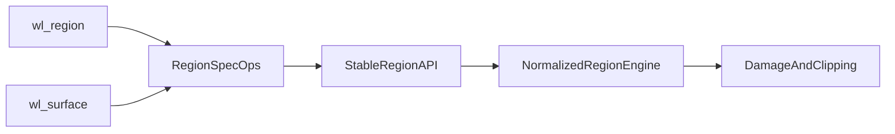

# Regions Foundation Notes

## Current Shape

The current implementation uses a hybrid, protocol-first region model:

- `src/region.rs` defines `RectI`, `RegionOp`, `RegionSpec`, and `RegionValue`
- `wl_region` stores an ordered add/subtract spec and snapshots it with copy semantics
- `wl_surface` stores committed `input_region` and `opaque_region` state separately from pending state
- input hit-testing consumes the committed region now
- opaque regions are preserved as metadata for later rendering and culling work

This keeps the Wayland object layer simple while avoiding an early commitment to a fully normalized region engine.

## Why Start Here

This repository is still building out its output, repaint, and damage architecture. A protocol-first layer gives us the needed Wayland semantics now:

- `wl_compositor.create_region`
- `wl_surface.set_input_region`
- `wl_surface.set_opaque_region`
- copy semantics from `wl_region` to `wl_surface`
- double-buffered surface region state

The important design constraint is that the Wayland-facing API should not need to change when we later grow a stronger compositor-owned region implementation.

## Future Option 2

The fuller option 2 design would keep the same object-layer behavior but replace the internals behind `RegionValue::Spec` with a normalized region engine.

That future engine would likely add:

- canonicalized rectangle storage instead of replaying ordered ops on every query
- cached extents for fast emptiness and bounds checks
- explicit geometry operations such as `union`, `subtract`, `intersect`, and `translate`
- reuse across input regions, opaque regions, surface damage, output damage, clipping, and culling

Conceptually, the evolution path looks like this:

## Migration Strategy

When we move to option 2, the intended migration is internal rather than API-visible:

1. Keep `wl_region` request handling and `wl_surface` pending/current fields as they are.
2. Change `RegionValue` internals so `contains()` no longer depends on raw op replay.
3. Add normalized helpers incrementally where new rendering or damage code needs them.
4. Reuse the same region layer in future damage accumulation and visibility/culling code.

If this goes well, the current protocol-first layer becomes the compatibility shell around a stronger compositor-native region core, not throwaway code.
